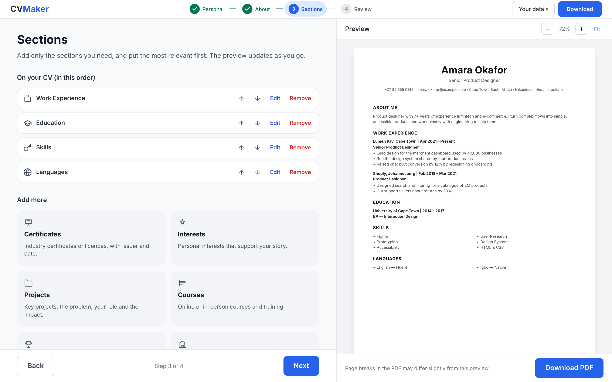

# CV Maker Pro

Build a clean, professional CV in a few minutes and download it as a **text-based A4 PDF** that applicant tracking systems (ATS) can read. No sign-up, no server: your CV stays in your browser.



## Features

- **Step-by-step editor**: personal details, an "About me" summary, then only the sections you need, in the order you choose.
- **Live preview** that fits the panel, with zoom controls.
- **Real PDF export** (via `@react-pdf/renderer`): selectable text, clickable links, proper page breaks, small files (~15 KB). Generated in the browser.
- **Undo** for every delete and bulk change (toast button or <kbd>Ctrl/⌘ + Z</kbd>).
- **Review step**: completeness checklist, problems to fix (missing name/email, end date before start date, invalid links, empty sections) with links straight to them.
- **Quick fixes**: rule-based helpers that tidy wording, add a "Key skills" line, or trim to key points. They are deliberately **not** labelled AI, because they aren't.
- **Your data**: autosaves to `localStorage`, plus backup to / restore from a JSON file, and "Start a new CV".
- **Accessible**: labelled fields, keyboard-friendly controls, visible focus, screen-reader announcements; checked with axe in CI.

## Getting started

Requires Node 20.19+ (see `.nvmrc`).

```bash
npm install
npm run dev
```

Open http://localhost:5173.

## Scripts

| Command                           | What it does                                                        |
| --------------------------------- | ------------------------------------------------------------------- |
| `npm run dev`                     | Start the dev server                                                |
| `npm run build`                   | Type-check and build to `dist/`                                     |
| `npm run preview`                 | Serve the production build (with production security headers)       |
| `npm run check`                   | Typecheck + lint + format check + unit tests (run before pushing)   |
| `npm test` / `npm run test:watch` | Unit and component tests (Vitest + Testing Library)                 |
| `npm run test:coverage`           | Unit tests with coverage report                                     |
| `npm run test:e2e`                | End-to-end tests in Chromium, desktop and mobile (Playwright + axe) |
| `npm run lint` / `npm run format` | ESLint / Prettier                                                   |

The first time you run e2e tests locally: `npx playwright install chromium`.

## How it works

```
src/
  cv/          Pure, framework-free logic (fully unit-tested)
    schema.ts      zod schema: single source of truth for the CV shape + types
    storage.ts     versioned save/load, migration from older data, backup files
    document.ts    turns CV data into a renderer-neutral "CvDocument"
    validation.ts  field and whole-CV checks, completeness checklist
    text.ts        rule-based writing helpers
    dates.ts       timezone-safe month/year formatting
    sections.ts    titles, descriptions and "is empty" rules per section
  state/       useCvStore: reducer with undo history and debounced autosave
  sections/    registry mapping each section to its icon and editor
  components/  React UI (wizard steps, editors, preview, toasts, error boundary)
  pdf/         react-pdf document + lazy-loaded export
e2e/           Playwright tests
```

Key decisions:

- **One document model, two renderers.** `buildCvDocument()` decides _what_ goes on the CV. `CvSheet` (HTML preview) and `CvPdf` (PDF) only decide _how it looks_, so the preview and the download can't disagree on content. Both are sized in `pt`; keep `.cv-*` in `styles.css` and the styles in `CvPdf.tsx` in sync.
- **Lazy PDF engine.** `@react-pdf/renderer` (~1.2 MB) loads only when the user clicks Download.
- **Lenient, versioned storage.** Saved data is wrapped as `{ app, version, savedAt, data }`. Every schema field has a fallback, so older or partly invalid data loads instead of being thrown away. Data from v1 (`cvData` key, string bullets) is migrated automatically.
- **Undo only where it matters.** Typing uses plain updates; deletes and bulk rewrites use `commit()`, which records a snapshot. A commit that changes nothing is ignored, so "Undo" never reverts something else.
- **Dates are calendar values.** `"2024-03"` is never passed to `new Date()` (that parses as UTC and showed "Feb 2024" west of UTC). Tests run in `America/New_York` to catch regressions.

## Deployment

Deployed on Vercel (`vercel.json`). It sets a strict Content-Security-Policy and other security headers; `vite preview` serves the same headers, so e2e tests cover them. Fonts (Inter) are self-hosted via `@fontsource/inter`, so no third-party requests are made.

## Known limitations

- The PDF font covers Latin scripts (including Western European accents). Names in other scripts (e.g. Cyrillic, CJK) won't render in the PDF yet.
- CV headings and month names are in English.
- Preview page breaks are approximate; the PDF paginates properly.

## Contributing

Run `npm run check` before pushing. CI (`.github/workflows/ci.yml`) runs typecheck, lint, format check, unit tests with coverage, build, a production `npm audit`, and the Playwright suite on every pull request.
